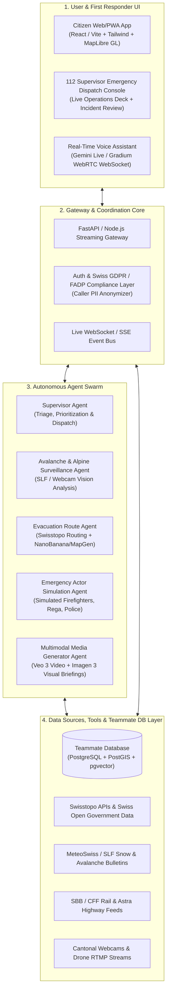

# AlpineGuard: Autonomous Emergency Response & Dispatch Platform (Switzerland)

## 1. Executive Architecture Overview

**AlpineGuard** is an AI-native autonomous emergency response and coordination platform tailored for Swiss public safety (112 / 117 / 118 / 144 / Rega 1414 / SLF Avalanche Institute). It bridges real-time Swiss open environmental sensors, autonomous multi-agent simulation and planning, multimodal generative media generation (Veo 3, Imagen 3, NanoBanana map routing), and real-time voice streaming (Gemini 3.8 Live API / Gradium audio).

---

## 2. Component 1: UI Interface for Users & Responders

### 2.1 Civilian / Incident Reporter Interface (PWA Mobile-First)
* **One-Tap Emergency Trigger**: Instant capture of GPS coordinates, battery level, elevation, and offline cached maps via MapLibre GL + Swisstopo vector tiles.
* **Autonomous Voice Assistant Mode**: Hands-free conversation for injured or panic-stricken citizens in English, German, French, and Italian.
* **Real-Time Dynamic Evacuation Guidance**:
  * Visual route overlay with live hazard zones (fire perimeter, avalanche paths, blocked mountain passes).
  * Synthesized step-by-step visual waypoints generated dynamically.
* **Status Card & Reassurance**: Real-time beacon status indicating rescue team dispatch ETA and live advice.

### 2.2 112 Dispatcher & Supervisor Operations Console (Desktop)
* **Incident Heatmap & Live Swarm Monitoring**: Multi-layer GIS tactical map showing caller locations, active drone streams, responder units, and terrain elevation contour.
* **Agent Decision Inspector**: "Human-in-the-Loop" validation panel where the 112 supervisor can review, approve, override, or escalate autonomous agent plans (e.g., closing a mountain rail segment, issuing a regional cell broadcast).
* **Live Media Feed**: Playback of agent-synthesized situational video simulations (Veo 3) and satellite/drone computer vision tags.

---

## 3. Component 2: Autonomous Agent Swarm & Generative Model Workflows

The platform deploys specialized autonomous agents operating concurrently under a **Supervisor Agent**:

### 2.1 Supervisor Dispatcher Agent
* **Role**: Primary triage officer. Ingests incident inputs, evaluates severity (Level 1-5), and orchestrates subordinate specialized agents.
* **Policy Engine**: Enforces legal limits (Swiss safety mandates, Cantonal emergency protocols, data privacy safeguards).
* **Model**: Gemini 3.8 Pro with function calling and structured reasoning.

### 2.2 Avalanche & Alpine Surveillance Agent
* **Role**: Continuously monitors alpine risk zones and webcam feeds across Swiss ski regions and passes.
* **Capabilities**:
  * Polls SLF (WSL Institute for Snow and Avalanche Research) bulletin levels and snowpack sensor telemetry.
  * Ingests cantonal highway and resort webcam snapshots every 60s, analyzing visual snow slip, visibility drops, and avalanche triggers using Gemini Vision.
  * Triggers immediate hazard zone recalculation if an event is detected.

### 2.3 Dynamic Evacuation Route Agent
* **Role**: Calculates safe escape paths factoring in terrain elevation, real-time fire spread or avalanche debris, blocked roads, and transport disruptions.
* **Capabilities**:
  * Integrates Swisstopo Digital Elevation Models (swissALTI3D) and OpenRouteService/Valhalla.
  * Employs **NanoBanana / Custom Vector Map Renderer** for generating simplified, ultra-clear evacuation route overlays for civilian devices under stress.

### 2.4 Multimodal Media Generator Agent (Veo 3 & Imagen 3)
* **Role**: Translates complex hazard telemetry into unambiguous visual media for dispatchers and civilians.
* **Workflows**:
  * **Real-time 3D Evacuation Video (Veo 3)**: Generates short 5-10 second simulated fly-through videos showing the exact evacuation trajectory through the pass or valley.
  * **Visual Situational Briefings (Imagen 3)**: Creates clear tactical schematics and landing zone sketches for air rescue (Rega helicopters).

### 2.5 Responder Simulation Agent (Demo & Readiness Sandbox)
* **Role**: Simulates other emergency actors (firefighter brigades, cantonal police, rescue drones, volunteers, and emergency transit) in real-time.
* **Capabilities**: Simulates radio communication chatter, ETA progression, and decentralized status updates to provide a realistic multi-party operational picture.

---

## 4. Component 3: Data Sources, External APIs & Database Architecture

### 4.1 Database Layer (Teammate Storage Integration)
* **Engine**: PostgreSQL 16 + **PostGIS** (geospatial operations) + **pgvector** (semantic search over incident logs and SOPs).
* **Core Schemas**:
  * `users_and_callers`: Anonymized identity tokens, phone hashes, spoken language, medical badges, live GPS lat/long/altitude, last ping timestamp.
  * `incidents`: Unique incident ID, severity level (1-5), incident category (avalanche, forest fire, flash flood, alpine trauma), status (`detected`, `evaluating`, `responders_dispatched`, `evacuating`, `resolved`), geo-polygon bounding box.
  * `agent_runs_and_checkpoints`: Tracks individual agent tasks, decision rationale, tool invocations, and approved supervisor overrides.
  * `live_assets`: Locations of ambulances, Rega rescue helicopters, drone swarms, snowplows, and volunteer responders.
  * `multimodal_artifacts`: Storage references (S3/Cloud Storage) for generated maps, Veo 3 evacuation clips, voice call recordings, and vision diagnostics.

### 4.2 Swiss Data Sources & Public APIs
1. **Federal Office of Topography (Swisstopo)**:
   - REST API / WMTS for official Swiss national maps, contour layers, and hiking trail networks.
2. **MeteoSwiss & SLF (WSL)**:
   - Live weather stations, wind gust data, precipitation radar, and avalanche risk level bulletins.
3. **Swiss Federal Railways (SBB / CFF / FFS) & Astra**:
   - Real-time train network interruptions and Swiss highway traffic/tunnel status feeds.
4. **Public Webcams & Cantonal Feeds**:
   - Swiss alpine webcam networks for live visual weather and slope surveillance.

---

## 5. Component 4: Integration Layer, Tooling & Real-Time Voice

### 5.1 Real-Time Autonomous Voice Assistant
* **Core Engine**: Gemini 3.8 Live API (`@google/genai` WebSocket) / Gradium Voice Assistant.
* **Real-Time Pipeline**:
  * Low-latency bidirectional audio streaming over WebSockets via WebRTC.
  * Voice Activity Detection (VAD) with interruptions support for fast, empathetic caller coaching.
  * Asynchronous Function Calling: Voice assistant triggers backend tools (e.g. `query_nearby_shelters`, `report_victim_count`, `request_evac_route`) while simultaneously speaking and comforting the caller.

### 5.2 Tool & Connector Registry
Standardized tool execution framework exposing:
* `get_weather_and_avalanche_risk(canton, coordinates)`
* `calculate_evacuation_path(start_coords, hazard_polygon)`
* `generate_evacuation_visual(route_geojson, prompt)` -> Calls Veo 3 / Imagen 3
* `anonymize_call_transcript(raw_audio_or_text)`
* `dispatch_simulated_unit(unit_type, target_coords)`
* `db_query_nearby_resources(postgis_point, radius_km)`

---

## 6. Implementation Roadmap & Milestones

| Phase | Milestone | Deliverables |
| :--- | :--- | :--- |
| **Phase 1** | **Foundation & Data Connectors** | Setup PostGIS database schema, integrate Swisstopo & SLF API connectors, deploy base FastAPI server. |
| **Phase 2** | **Agent Swarm & Logic Layer** | Implement Supervisor Agent, Avalanche Vision Agent, and Evacuation Router using Gemini function calling. |
| **Phase 3** | **Multimodal Generation Pipeline** | Connect Veo 3 video generation for fly-through evacuation paths and NanoBanana vector map export. |
| **Phase 4** | **Real-Time Voice Assistant** | Integrate Gemini 3.8 Live / Gradium WebRTC audio assistant into the mobile PWA UI. |
| **Phase 5** | **Dispatcher UI & Simulation Sandbox** | Complete the 112 Supervisor Console with simulated responder units and live incident scenario testing. |
