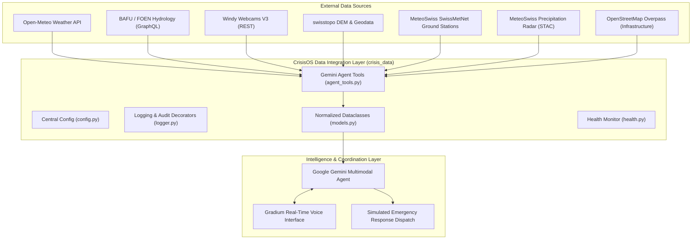

# CrisisOS Switzerland — Architecture & Feature Design Document

> Implementation status (2026-10-22): this branch implements the data clients and tool interface. Gemini reasoning, Gradium voice, deployed interfaces, and real dispatch remain broader integration plans. Historical provider-health claims below were not revalidated by the documentation audit.

This document records the system architecture, component breakdown, module responsibilities, and implemented features for **CrisisOS Switzerland**.

---

## 1. System Overview & Vision

**CrisisOS** is an autonomous, multimodal disaster intelligence and emergency coordination platform focused on Switzerland, initially targeting flood risk management along the **Limmat** and **Sihl** rivers in the Canton of Zurich.

The system connects live environmental sensors (river levels, discharge, rainfall, weather station networks), geographical models (swisstopo DEM, flood zones), visual confirmation (Windy webcams), and critical infrastructure databases (OSM hospitals, bridges, fire stations) into a cohesive agentic pipeline powered by **Google Gemini** and voice-enabled by **Gradium**.

---

## 2. Centralized Configuration & Standards

All system constants, endpoint URLs, bounding coordinates, model names, and logging parameters reside centrally in [`crisis_data/config.py`](crisis_data/config.py):

- **Model identifiers**: e.g., `gemini-2.5-flash`, `gemini-2.5-pro`.
- **Zurich bounding box & default stations**: Sihl (2176), Limmat (2099), SMA Fluntern.
- **Timeouts & Caching TTL**: 15s default HTTP timeout, 15-minute TTL for OSM queries.
- **Authentication**: Ingested strictly via `.env` / environment variables (`WINDY_API_KEY`, `GEMINI_API_KEY`).

Every function execution is logged at `INFO` level using `@log_function_call` in [`crisis_data/logger.py`](crisis_data/logger.py), sanitizing large binary payloads (such as base64 images) to keep audit logs clean and secure.

---

## 3. Implemented Modules & Feature Breakdown

| Feature                          | Source File                                                              | Description & Use Cases                                                                                                          |
| :------------------------------- | :----------------------------------------------------------------------- | :------------------------------------------------------------------------------------------------------------------------------- |
| **System Guidelines**            | [`AGENTS.md`](AGENTS.md)                                                 | Coding and documenting guidelines, modularity requirements, and logging rules.                                                   |
| **Central Configuration**        | [`crisis_data/config.py`](crisis_data/config.py)                         | Centralized storage for model names, endpoints, Zurich coordinates, and timeouts.                                                |
| **Audit & Logging**              | [`crisis_data/logger.py`](crisis_data/logger.py)                         | Function call logger (`@log_function_call`) and GenAI call logger with payload sanitization.                                     |
| **Normalized Data Schemas**      | [`crisis_data/models.py`](crisis_data/models.py)                         | Pydantic / dataclass schemas (`NormalizedObservation`, `CameraMetadata`, `InfrastructureItem`, `DataSourceHealth`).              |
| **Weather Forecasts**            | [`crisis_data/open_meteo.py`](crisis_data/open_meteo.py)                 | Priority 1: Current weather, precipitation, 24h rain totals, and hourly outlooks from Open-Meteo.                                |
| **Hydrological Monitoring**      | [`crisis_data/bafu_hydro.py`](crisis_data/bafu_hydro.py)                 | Priority 2: Real-time river water levels ($W$), discharge rate ($Q$), and temperatures from BAFU GraphQL.                        |
| **Visual Webcam Intelligence**   | [`crisis_data/windy_webcams.py`](crisis_data/windy_webcams.py)           | Priority 3: Camera discovery near Zurich bridges/rivers and multimodal image download for Gemini visual verification.            |
| **Geospatial & Elevation**       | [`crisis_data/swisstopo.py`](crisis_data/swisstopo.py)                   | Priority 4: Ground elevation from swisstopo Height API, WGS84 $\leftrightarrow$ LV95 coordinate conversions, Geoportal links.    |
| **Ground Station Observations**  | [`crisis_data/meteoswiss_smn.py`](crisis_data/meteoswiss_smn.py)         | Priority 5: High-precision 10-minute automated ground weather observations from SwissMetNet (`sma`, `reh`, `klo`).               |
| **Precipitation Radar**          | [`crisis_data/meteoswiss_radar.py`](crisis_data/meteoswiss_radar.py)     | Priority 6: STAC discovery for national 5-minute radar composites across Switzerland.                                            |
| **Critical Infrastructure**      | [`crisis_data/osm_infrastructure.py`](crisis_data/osm_infrastructure.py) | Priority 7: Identification of nearby hospitals, fire stations, and vulnerable bridges from OpenStreetMap Overpass.               |
| **ASTRA Road Traffic**           | [`crisis_data/astra_traffic.py`](crisis_data/astra_traffic.py)           | Priority 8: Real-time road closures, incidents, and congestion on Swiss motorways (A1, A3) via opentransportdata.swiss DATEX II. |
| **Swiss Flood Hazard Maps**      | [`crisis_data/flood_hazard.py`](crisis_data/flood_hazard.py)             | Priority 9: Official BAFU Aquaprotect 100-year flood zone spatial evaluation via geo.admin.ch WMS GetFeatureInfo in EPSG:2056.   |
| **Official Hazard Warnings**     | [`crisis_data/hazard_warnings.py`](crisis_data/hazard_warnings.py)       | Priority 10: Official Swiss federal natural hazard warnings (levels 1-5) from natural-hazards.ch / MeteoSwiss alerting feed.     |
| **ETH Seismological Service**    | [`crisis_data/sed_earthquakes.py`](crisis_data/sed_earthquakes.py)       | Priority 11: Real-time Swiss earthquake monitoring catalog (magnitude, depth, epicenter) via ETH SED FDSN Web Service.           |
| **Swiss Population & Buildings** | [`crisis_data/bfs_population.py`](crisis_data/bfs_population.py)         | Priority 12: Building stock (BFS GWR) and demographic exposure metrics (STATPOP) via geo.admin.ch MapServer find service.        |
| **Data Health Monitor**          | [`crisis_data/health.py`](crisis_data/health.py)                         | Dynamic diagnostics across all 12 external data sources, producing automated Markdown health reports.                            |
| **Gemini Tool Interface**        | [`crisis_data/agent_tools.py`](crisis_data/agent_tools.py)               | Standalone callable functions with standard typed signatures ready for Gemini Tool declarations.                                 |
| **Integration Test Suite**       | [`test_integrations.py`](test_integrations.py)                           | End-to-end smoke test runner verifying connectivity, real data retrieval, and data freshness across all 12 sources.              |

---

## 4. Agent Tools Integration Contract

The data layer exposes the following standardized functions for Gemini reasoning:

1. `get_weather(latitude: float = 47.3769, longitude: float = 8.5417) -> Dict[str, Any]`
2. `get_river_stations() -> List[Dict[str, Any]]`
3. `get_river_measurements(station_no: str = "2176") -> Dict[str, Any]`
4. `get_nearby_webcams(latitude: float = 47.3769, longitude: float = 8.5417, radius_km: float = 15.0) -> List[Dict[str, Any]]`
5. `get_webcam_image(camera_id: str, image_url: Optional[str] = None) -> Dict[str, Any]` (returns base64 image payload)
6. `get_weather_stations(radius_km: float = 30.0) -> List[Dict[str, Any]]`
7. `get_precipitation_radar(limit: int = 5) -> Dict[str, Any]`
8. `get_nearby_infrastructure(latitude: float = 47.3769, longitude: float = 8.5417, radius_km: float = 3.0) -> List[Dict[str, Any]]`
9. `get_traffic_incidents(road_filter: Optional[str] = None) -> List[Dict[str, Any]]`
10. `check_flood_hazard(latitude: float = 47.3769, longitude: float = 8.5417, return_period: int = 100) -> Dict[str, Any]`
11. `get_hazard_warnings(plz: str = "800100") -> List[Dict[str, Any]]`
12. `get_warning_summary(plz: str = "800100") -> Dict[str, Any]`
13. `get_recent_earthquakes(min_magnitude: float = 0.5, limit: int = 10) -> List[Dict[str, Any]]`
14. `get_earthquake_summary() -> Dict[str, Any]`
15. `get_building_exposure(postal_code: int = 8001, limit: int = 50) -> List[Dict[str, Any]]`
16. `get_population_exposure_metrics(postal_code: int = 8001) -> Dict[str, Any]`
17. `get_data_source_health() -> List[Dict[str, Any]]`

---

## 5. Fail-Safe Mechanics & Graceful Degradation

In disaster intelligence and life-critical emergency coordination, transient network outages or upstream governmental service failures must never be misrepresented as "all clear" or crash the reasoning loop. All CrisisOS data integrations adhere to strict fail-safe conventions:

1. **Flood Hazard Zoning Fail-Safe (`flood_hazard.py`)**:
   - If the external `geo.admin.ch` WMS service times out, is unreachable, or returns a non-200 HTTP code, `risk_level` is explicitly set to `"UNKNOWN"`, `data_available` to `False`, and `status` to an explanatory error code (e.g. `NETWORK_ERROR`, `HTTP_ERROR_503`). It never defaults to `is_in_flood_zone = False` or `risk_level = "NONE"`.

2. **BAFU Hydrological Resilience & Security (`bafu_hydro.py`)**:
   - `BafuHydroClient.execute_graphql()` wraps network requests and JSON decoding in `try...except (requests.RequestException, ValueError, KeyError)`.
   - On network or server failure, it returns a structured payload with error details. `get_river_measurements()` returns a degraded dictionary with `status="DATA_UNAVAILABLE"`, `data_available=False`, and zeroed counts, preventing unhandled exceptions from terminating Gemini tool-calling routines.
   - **GraphQL Parameterization**: To prevent GraphQL query injection vulnerabilities via user- or agent-supplied station identifiers, `get_river_measurements()` uses strongly-typed GraphQL variables (`query GetLiveStationData($stationNo: String!)`) with variable dictionary mapping (`variables={"stationNo": str(station_id).strip()}`) rather than f-string interpolation.

3. **Federal Natural Hazard Alerts Resilience (`hazard_warnings.py`)**:
   - `HazardWarningsClient` tracks `last_fetch_success` and `last_fetch_error`.
   - If `natural-hazards.ch` is unreachable, `get_warning_summary()` sets `has_active_warnings = None`, `max_warning_level = None`, `max_warning_label = "Data Unavailable"`, and `status = "DATA_UNAVAILABLE"`, preventing upstream outages from falsely reporting "all clear / minor danger".

4. **OpenStreetMap Overpass Resilience (`osm_infrastructure.py`)**:
   - `OverpassInfrastructureClient.get_nearby_infrastructure()` cycles across 4 public Overpass mirrors with timeout protection.
   - If all mirrors fail or return malformed JSON, rather than crashing downstream Gemini tool calling with an unhandled exception, it gracefully degrades to `_get_fallback_infrastructure()`, returning curated critical infrastructure in Zurich (USZ Hospital, Triemli, Berufsfeuerwehr Süd, Neugasse, Quaibrücke, Münsterbrücke) tagged with `is_simulated=True` and `source="OpenStreetMap (Fallback)"`.

5. **ASTRA Road Traffic Incident Resilience (`astra_traffic.py`)**:
   - Catches `ET.ParseError` during DATEX II XML parsing and returns a structured fallback `TrafficIncident` record with `is_simulated=True` and `incident_type="xml_parse_error"`, preventing malformed XML payloads from silently appearing as "zero incidents / roads clear".
   - Handles network and authorization failures by returning structured incidents with `is_simulated=True`.

6. **ETH Swiss Seismological Service Resilience (`sed_earthquakes.py`)**:
   - `SedEarthquakeClient` tracks `last_fetch_success` and `last_fetch_error`.
   - On network outage or FDSN service unavailability, `get_recent_earthquakes()` returns a structured fallback record marked with `is_simulated=True` and `event_type="service_unavailable"`.
   - `get_earthquake_summary()` returns `status="DATA_UNAVAILABLE"`, `is_simulated=True`, `data_available=False`, `max_magnitude=None`, and `has_recent_activity=None`, clearly distinguishing upstream outages from quiet seismic periods.

7. **Swiss Population & Building Exposure Resilience (`bfs_population.py`)**:
   - `BfsPopulationClient` guards against malformed responses or register outages by catching `(requests.exceptions.RequestException, ValueError, KeyError)` (including `json.JSONDecodeError`).
   - Defensively casts numeric attributes (`dplz4`, `gbauj`, `gastw`, `garea`) with per-field exception guards to prevent a single malformed register record from terminating entire building inventory queries.
   - On failure, returns fallback records tagged with `is_simulated=True`, while `get_population_exposure_metrics()` sets `status="DATA_UNAVAILABLE"`, `is_simulated=True`, and `sample_buildings_analyzed=0` to ensure safe downstream degradation in Gemini agent reasoning loops.

8. **Uniform Graceful Degradation Across Connectors**:
   - **Open-Meteo (`open_meteo.py`)**: Catches network/timeout exceptions and returns nominal geographic coordinates with `status="DATA_UNAVAILABLE"` and `is_simulated=True`.
   - **swisstopo (`swisstopo.py`)**: Reverts to nominal Zurich baseline elevation (408.0m) with `is_simulated=True` and `status="DATA_UNAVAILABLE"` on connection drop.
   - **MeteoSwiss Radar STAC (`meteoswiss_radar.py`)**: Returns fallback spatial metadata and empty asset lists with `status="DATA_UNAVAILABLE"`.
   - **MeteoSwiss SwissMetNet SMN (`meteoswiss_smn.py`)**: Catches CSV download and parsing failures, returning station metadata with `status="DATA_UNAVAILABLE"`.
   - **Windy Webcams (`windy_webcams.py`)**: Catches HTTP/network errors and falls back to curated reference cameras (`_get_fallback_zurich_cameras()`) and returns structured `status="ERROR"` on image fetch failure instead of raising unhandled exceptions.

---

## 6. Next Planned Milestones

1. **Gemini Agent Multimodal Orchestration**:
   - Implement Gemini 2.5 Flash / Pro system prompt incorporating tools from [`crisis_data.agent_tools`](crisis_data/agent_tools.py).
   - Multimodal prompt flow: Compare river discharge threshold warnings with latest webcam imagery.
2. **Gradium Voice Interface**:
   - Bind audio input/output stream to the agent decision loop for hands-free commander queries.
3. **Simulated Response Dispatch**:
   - Compute risk-weighted routing to endangered bridges and dispatch simulated civil defense units.
